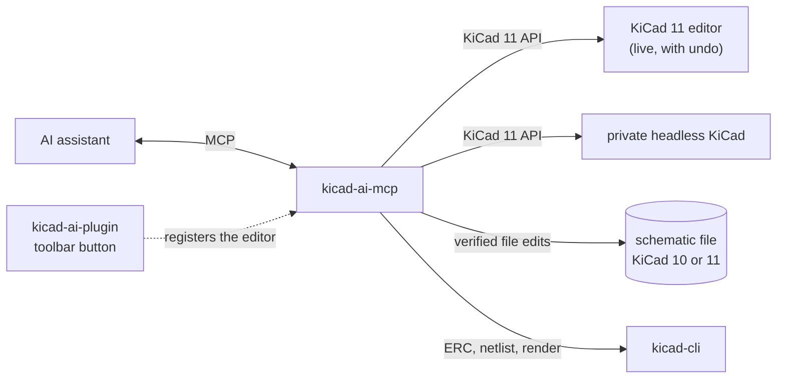

<h1 align="center">thingsvu-tools</h1>

<p align="center">
  <b>AI-assisted design tools for embedded products — schematic, PCB, and enclosure — built on KiCad.</b>
</p>

<p align="center">
  <a href="https://github.com/bkrajendra/thingsvu-tools/releases"></a>
  <a href="https://github.com/bkrajendra/thingsvu-tools/actions/workflows/ci.yml"></a>
  <a href="#project-status"></a>
  <a href="LICENSE"></a>
  
  
  
  
  <a href="https://github.com/sponsors/bkrajendra"></a>
</p>

---

## What is thingsvu-tools?

thingsvu-tools lets an AI assistant work alongside you in KiCad. You describe the circuit you want; the assistant plans the change, shows you exactly what it will do, and — once you approve — builds it in your schematic. Every result is checked against KiCad itself before it is reported back to you.

It connects to any assistant that speaks the [Model Context Protocol](https://modelcontextprotocol.io) (MCP), such as Claude Desktop, Claude Code, or VS Code.

## Why it's different

- **You stay in control.** Changes are proposed as a plan first. Nothing touches your design until you confirm it, and a stale plan is never applied to a document that has changed.
- **Verified, not assumed.** After every change, the tools read the design back from KiCad — symbols, values, and net connections — and run ERC. A check that couldn't run is reported as such, never as a pass.
- **Readable schematics.** Generated schematics read like a person drew them: signal flows left to right, power and ground are symbols, parts are wired, not just labelled.
- **Describe intent, not coordinates.** Say "R1 pin 2 and R2 pin 1 share net MID"; the tools take care of placement, wiring, and labels on the proper grid.
- **Built on KiCad's official API.** First-class support for KiCad 11's schematic API, with a fallback that works on KiCad 10 through the schematic file. You always know which features your KiCad version supports.
- **Works live, headless, or on a file.** Co-edit in the open Schematic Editor with normal undo, generate and verify designs without a GUI, or edit a schematic file with no KiCad running at all.
- **Local and private.** Everything runs on your machine. No cloud service, no open network ports, and your design files stay where they are.
- **Fast and dependable.** Written in Rust as a small set of native binaries — no Python runtime to manage.

## Quick start (Windows)

You need **KiCad 11** (or the 10.99 nightly) for live editing, or **KiCad 10** for the file mode, and an AI assistant that supports MCP. No administrator rights are needed: everything is installed under your user profile.

### 1. Install

**Option A — download.** Get `thingsvu-tools-v<version>-windows-x64.zip` from the [latest release](https://github.com/bkrajendra/thingsvu-tools/releases/latest), extract it, and run `install.ps1` (right-click → **Run with PowerShell**).

**Option B — one line.** In PowerShell:

```powershell
irm https://raw.githubusercontent.com/bkrajendra/thingsvu-tools/main/scripts/install.ps1 | iex
```

This downloads the newest release, checks it against its published checksum, and installs it. Read the [script](scripts/install.ps1) first if you like; it is short.

The installer:

1. puts `kicad-ai-mcp.exe` in `%LOCALAPPDATA%\thingsvu\kicad-ai\bin`;
2. installs the **KiCad AI** plugin into your KiCad 11 plugin folder (`Documents\KiCad\<version>\plugins`) — KiCad 10 cannot run schematic plugins, so it is skipped there;
3. offers to add the server to **Claude Code** and **Claude Desktop** (it keeps a backup of any settings file it changes);
4. tells you what to do next.

Useful options: `-Yes` (answer yes to everything), `-NoPlugin`, `-SkipClients`, `-KicadVersion 11.0`, `-Version 0.1.0`.

### 2. Turn on KiCad's API (KiCad 11, live editing)

In KiCad: **Preferences → Plugins**, enable the **KiCad API**, then restart KiCad. If you only use the file mode, skip this.

### 3. Connect your assistant

The installer does this for Claude Code and Claude Desktop. For anything else, the server is a program that speaks MCP over stdio:

<details>
<summary><b>Claude Code</b></summary>

```powershell
claude mcp add --scope user kicad-ai -- "$env:LOCALAPPDATA\thingsvu\kicad-ai\bin\kicad-ai-mcp.exe"
```
</details>

<details>
<summary><b>Claude Desktop</b></summary>

Add to `%APPDATA%\Claude\claude_desktop_config.json`, then restart Claude Desktop:

```json
{
  "mcpServers": {
    "kicad-ai": {
      "command": "C:\\Users\\<you>\\AppData\\Local\\thingsvu\\kicad-ai\\bin\\kicad-ai-mcp.exe",
      "args": []
    }
  }
}
```
</details>

<details>
<summary><b>VS Code</b></summary>

Add to `.vscode/mcp.json` in your workspace:

```json
{
  "servers": {
    "kicad-ai": {
      "type": "stdio",
      "command": "C:/Users/<you>/AppData/Local/thingsvu/kicad-ai/bin/kicad-ai-mcp.exe"
    }
  }
}
```
</details>

Add `"--read-only"` to the arguments to let the assistant look but never change anything.

### 4. Try it

Ask your assistant:

> Call `session_status` and tell me what KiCad installs and sessions you can see.

Then, with a schematic that is **not** open in KiCad (any KiCad version):

> Open `D:\projects\demo\demo.kicad_sch` with the file provider and build a 3.3 V regulator from 5 V: a fuse, a Schottky diode, an AMS1117-3.3 with decoupling capacitors, and a power LED. Show me the plan first.

Or live, with KiCad 11: open your project in the **Schematic Editor**, press the **KiCad AI: connect** toolbar button (a small dialog confirms), then:

> Open the schematic in my KiCad editor (gui provider) and add an NE555 astable blinker driving an LED.

The assistant plans, shows you the parts, positions, and nets, and waits for your OK. Applying a plan in the live editor is two undo steps (**Ctrl+Z** twice).

## Three ways to work

| Provider | KiCad | What it does | Choose it when |
|---|---|---|---|
| `gui` | 11 | Edits the schematic open in your editor, live, with undo | You want to co-edit and watch it happen |
| `headless` | 11 | Starts a private KiCad in the background and works on a file | You want to generate or check designs without a GUI |
| `file` | 10 or 11 | Edits the `.kicad_sch` file itself; every change is verified with `kicad-cli` in a copy before it replaces the file | You use KiCad 10, or want no KiCad running. The file must not be open in an editor |

What each can do in detail: [capability matrix](docs/capability-matrix.md).

## Tools

| Tool | What it does |
|---|---|
| `session_status` | KiCad installs found, open sessions, and what each can do |
| `session_open` / `session_close` | Open a schematic (or create one) and close it again |
| `session_list_documents` | Documents open in the session's KiCad |
| `sch_list_symbols` / `sch_get_symbol_pins` | Read parts and their pins, positions, and types |
| `sch_get_netlist` | Connectivity as KiCad's netlister sees it |
| `sch_plan_changes` | Turn a circuit (parts and nets) into an exact, reviewable plan. Changes nothing |
| `sch_apply_plan` | Apply a plan you confirmed, verify it against KiCad, and report any difference |
| `sch_save` | Save the schematic |
| `sch_run_erc` | Electrical rules check |
| `sch_export_netlist` | Write a KiCad netlist |
| `sch_render` | A PNG of the schematic, so the layout can be checked visually |
| `sch_create_demo_circuit` | A two-resistor demo for a quick end-to-end check |

## Troubleshooting

| Problem | What to do |
|---|---|
| No **KiCad AI: connect** button | Restart KiCad after installing. The plugin must be in `Documents\KiCad\<version>\plugins\com.thingsvu.kicad-ai` (your Documents folder may be redirected, e.g. to OneDrive; the installer handles that). It needs KiCad 11 or the 10.99 nightly, and the button appears in the Schematic Editor |
| `session_status` shows no editors | Enable the KiCad API in Preferences → Plugins, restart KiCad, then press the button again |
| `DOCUMENT_OPEN_ELSEWHERE` | The file is open in a KiCad editor. Use the `gui` provider for that editor, or close it before using `file` or `headless` |
| `STALE_PLAN` | The schematic changed after the plan was made. Ask for a new plan |
| `FEATURE_UNAVAILABLE` for rendering | KiCad 10's `kicad-cli` cannot export PNG. Install KiCad 11 (or the 10.99 nightly) next to it |
| "format version … is older" | Open and save the file once in KiCad 10, or run `kicad-cli sch upgrade <file>`, then try again |
| A symbol is not found | Symbols come from the schematic itself, the project's `sym-lib-table`, and KiCad's standard libraries. Libraries only in your global library table are not read yet |
| Windows SmartScreen warning | The binaries are not code-signed yet. Compare the file's SHA-256 with `SHA256SUMS.txt` on the release page |
| Something else | Logs are in `%LOCALAPPDATA%\thingsvu\kicad-ai\logs` (the last 7 days). Run `kicad-ai-mcp --help` for options |

## Updating and removing

- **Update:** run the installer again (a newer release replaces the old files). Close your assistant first if it holds the server open.
- **Remove:** run `%LOCALAPPDATA%\thingsvu\kicad-ai\uninstall.ps1`. It removes the server, the plugin, registrations, logs, and the assistant entries the installer added, and nothing else. Your schematics and KiCad's own settings are never touched.

## What's included

| Component | What it does |
|---|---|
| **kicad-ai-mcp** | The MCP server your AI assistant talks to |
| **kicad-ai-plugin** | A KiCad plugin that makes your open editor available to the assistant |
| **kicad-domain** | The shared circuit model: plans, validation, layout, and readability checks |
| **kicad-session**, **kicad-ipc**, **kicad-sexpr**, **kicad-cli-runner** | Sessions over KiCad's API or a schematic file; the API client; KiCad file reading and writing; `kicad-cli` jobs |



More detail: [architecture](docs/architecture.md).

## Build from source

You need [Rust](https://rustup.rs) (stable) and [`protoc`](https://github.com/protocolbuffers/protobuf/releases) on your `PATH`.

```powershell
cargo build --release -p kicad-ai-mcp -p kicad-ai-plugin
cargo test --workspace                         # no KiCad needed
$env:KICAD_LIVE = '1'; cargo test --workspace -- --test-threads=1   # against your KiCad installs
.\scripts\package.ps1                           # release zip, PCM zip, checksums in .\dist
.\scripts\install-plugin.ps1                    # developers: just the plugin, from your build
```

How releases are made: [releasing](docs/releasing.md).

## Roadmap

- **Now:** schematic inspection and editing, readable generated schematics (signal flow left to right, power symbols, wires), ERC, netlist export, verified demo circuits, KiCad 10 through the schematic file, and a one-step installer
- **Next:** layout editing tools (move, rotate, rewire), PCB tools, hierarchical schematics, part and BOM assistance
- **Later:** 3D enclosure design driven from your PCB, so the whole embedded product comes together in one workflow

## Project status

thingsvu-tools is in early development and is not ready for production designs yet. The architecture and plan are in [`docs/`](docs/README.md).

AI-generated designs do not replace qualified engineering review. Always review and verify a design before manufacturing it.

## Supported KiCad versions

| KiCad | Support |
|---|---|
| 11 (currently nightly 10.99) | First-class: full schematic editing, live and headless |
| 10.0.x | Fallback through the schematic file: inspection, ERC, netlist, and editing of schematics no editor has open (each change is checked with `kicad-cli` before it replaces the file) |

## Sponsor

If thingsvu-tools is useful to you, please consider [sponsoring its development](https://github.com/sponsors/bkrajendra). Sponsorship helps keep the project independent and moving forward.

## License

thingsvu-tools is free software, licensed under the [GNU General Public License v3.0 or later](LICENSE). thingsvu-tools is an independent project and is not affiliated with or endorsed by the KiCad project.
