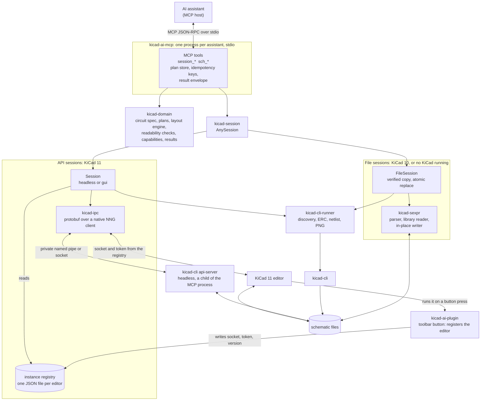
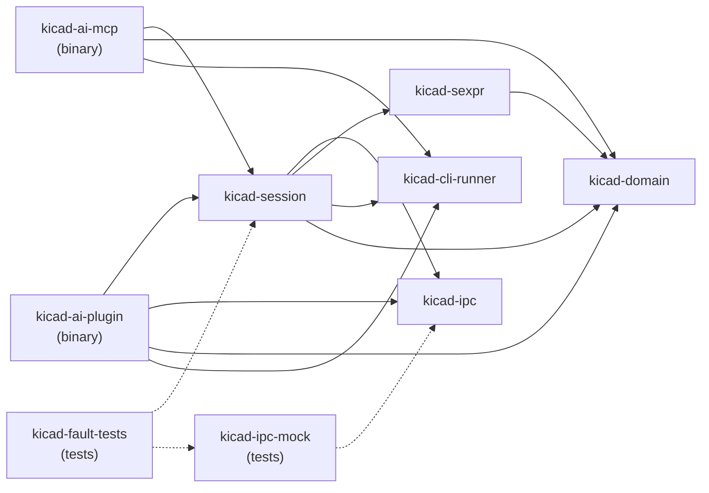
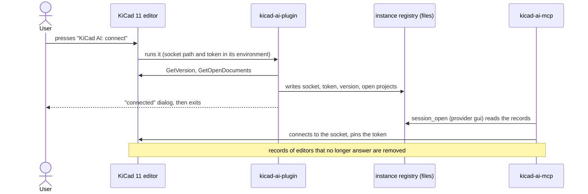
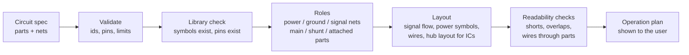
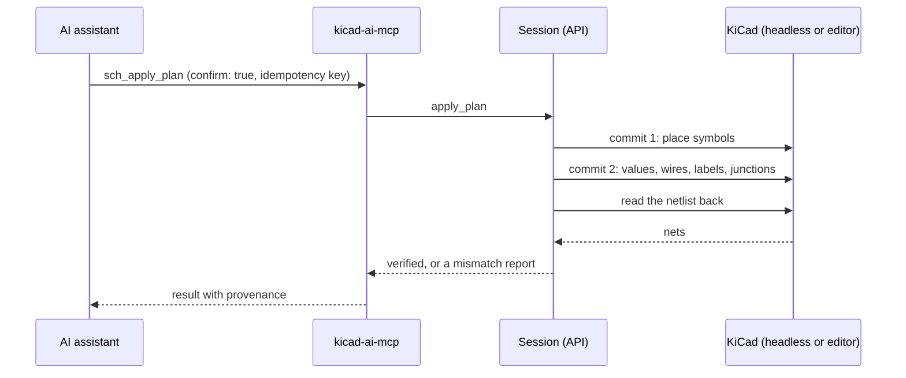
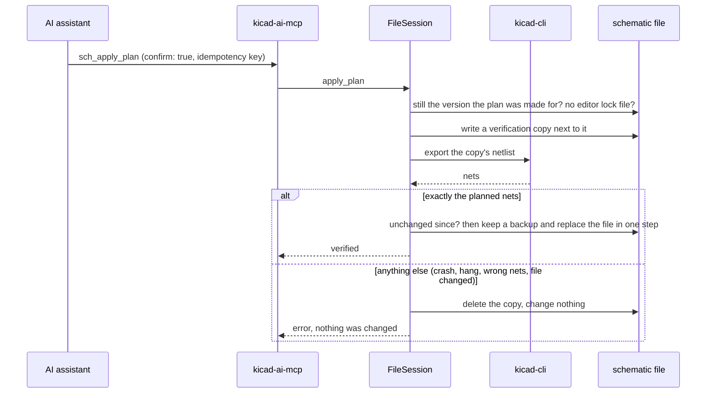
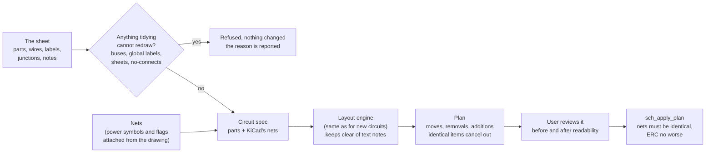
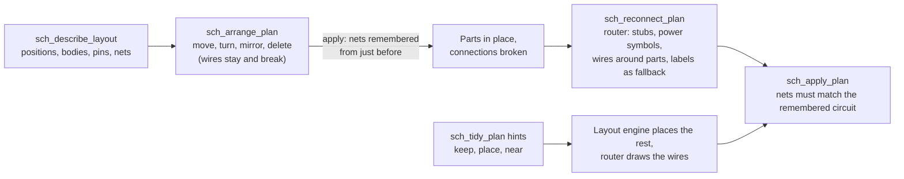
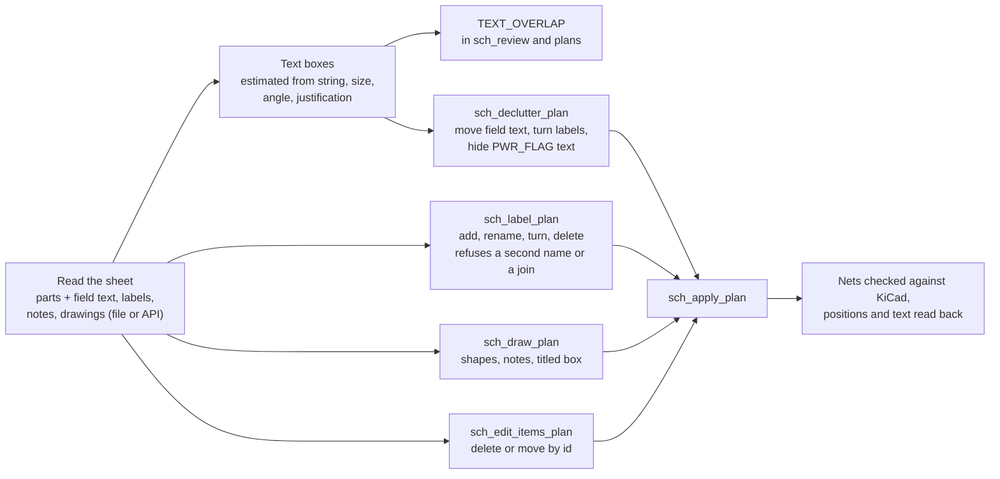
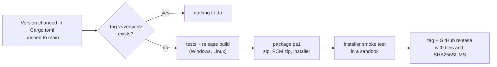

# Architecture

How thingsvu-tools is built **as of version 0.1**. The design plan ([kicad-ai-mcp-design-plan.md](kicad-ai-mcp-design-plan.md)) holds the reasoning and the history; where the two differ, this page is right. [Changes from the plan](#changes-from-the-original-plan) lists what moved.

## The pieces

Every provider produces the same kind of session, so the tools do not care which one they are talking to. What each can do is probed (API sessions) or fixed (file sessions) and reported in the capability matrix: [capability-matrix.md](capability-matrix.md).

## Crates

| Crate | Responsibility | Must not |
|---|---|---|
| `kicad-domain` | Circuit spec, validation, geometry, plans and their operations, the layout engine and its readability checks, the tidy planner, the arrange planner, and the router for existing designs, capability and result types | Depend on a transport, KiCad, or the file system |
| `kicad-ipc` | KiCad's protobuf API (vendored protos), the NNG `ipc` transport written in Rust, request deadlines, status mapping | Leak protobuf types upward |
| `kicad-cli-runner` | Finds KiCad installs; runs `kicad-cli` with fixed argument arrays (ERC, netlist, PNG); parses reports | Use a shell, or treat exit code 0 as proof of correctness |
| `kicad-sexpr` | Parses KiCad files keeping source positions; reads symbol libraries and schematics; writes a plan into a schematic by editing only the text the plan names (inserting new items, deleting old ones, changing a symbol's numbers) | Re-print a file; change its format version |
| `kicad-session` | `Session` (headless or gui, over the API), `FileSession`, and `AnySession` over both; capability probing; applying a plan and verifying it; the editor registry | Fall back to another backend after KiCad rejected a request |
| `kicad-ai-mcp` | The MCP tools, plan store, idempotency, result envelopes, logging | Write anything but MCP messages to stdout |
| `kicad-ai-plugin` | Runs when the user presses the toolbar button; registers the editor | Serve requests; stay running |

## Sessions

| Provider | KiCad | Opened with | What it works on | Edits via |
|---|---|---|---|---|
| `headless` | 11 | `session_open` (a file, or `create: true`) | A private `kicad-cli api-server` the MCP process starts and owns | The API, in two commits |
| `gui` | 11 | The user presses **KiCad AI: connect**, then `session_open` with `provider: gui` | The user's open Schematic Editor | The API, in two commits; each is one undo step in the editor |
| `file` | 10 or 11 | `session_open` with `provider: file` | The `.kicad_sch` file, when no editor has it open | Text edits, verified in a copy first |

One provider works on a document at a time. A file that an editor has open (its `~name.kicad_sch.lck` lock file) is never edited through the headless or file provider.

### How the editor registration works

There is no protocol between the MCP server and the plugin. KiCad only passes its API socket and token to a plugin it launches, so the plugin writes them down and the MCP server picks them up.

## Planning and applying a change

An assistant describes **what** the circuit is (parts and which pins share a net). The tools decide **where** things go, show the plan, and only change the design after the user confirms.

Applying differs by provider, but both end in the same check: KiCad's own netlist must show exactly the planned nets.

## Tidying an existing schematic

The same engine that lays out a new circuit can lay out an existing one. The circuit is read back from the sheet (the parts, and the nets KiCad reports), laid out again, and the difference becomes a plan of **moves** (each part keeps its identity, values, footprint, and fields), **removals** (the old wires, labels, junctions, and net-naming power symbols), and **additions** (the new drawing). One plan store and one apply tool serve both new circuits and tidies.

### Placing parts by hand, then reconnecting

Moving parts and drawing the connections are separate steps, so an assistant can place everything where it belongs and wire once. `sch_arrange_plan` changes only the named parts (wires stay and break); the server remembers the nets KiCad reported just before the first such change; `sch_reconnect_plan` then removes the old wiring and draws it again around the parts where they are, with a router that never crosses a part or touches another net (and falls back to labels). The same router draws the wires when `sch_tidy_plan` is given layout hints.

### Text, labels, and drawings (Phase 9)

KiCad decides where a part's reference and value text lands, and its API cannot report how far text extends (`GetBoundingBox` is not handled for schematics). The server therefore reads where the text is (position, angle, size, justification), estimates the area it covers, and checks it against other text, wires, and other parts' bodies. `sch_declutter_plan` moves the text that runs into something; the label, drawing, and item planners are ordinary plans, so they use the same confirm, apply, and verify flow. After applying, every position, turn, and text move is read back and compared with the plan.

How the three providers apply it:

| Provider | Applying | If it fails |
|---|---|---|
| `gui` | Two commits through the API (two undo steps); each part's text is moved with it, because the API leaves it behind | Before the first commit: nothing changed. After it: the error says how many times to press Ctrl+Z |
| `headless` | The same two commits; refuses to start with unsaved changes | The saved file is reloaded, undoing everything |
| `file` | The text edits go into a verified copy, which replaces the file in one step | The file is untouched |

## Releases

See [releasing.md](releasing.md).

## Changes from the original plan

The plan was written before any code existed. These are the places where building it led somewhere else.

| Plan | What was built | Why |
|---|---|---|
| A `KiCadBackend` trait with IPC, CLI, and file backends chosen per operation | `AnySession`, an enum over `Session` (API) and `FileSession`; the CLI is a helper both use | Only two real kinds of session exist; a trait added nothing, and each operation's backend is reported in the capability matrix anyway |
| A plugin that is a bridge with its own protocol (`kicad-ai-bridge/v1`) to the MCP server | A **registrar**: the plugin writes the editor's socket and token to a file and exits; the MCP server connects to KiCad directly | KiCad gives the plugin its connection details but the plugin does not need to stay alive to serve requests; this removes a protocol, a process, and a failure mode |
| A `DirectSocketProvider` to attach to a running KiCad 10 | Not built | KiCad 10's API answers almost nothing and only the first KiCad on Windows gets an endpoint; the lock file is a better guard against an open editor |
| A lossless syntax tree in `kicad-sexpr` | Source-position parser plus a writer that edits text in place | Nothing is re-printed, so everything a plan does not name is untouched by construction; Phase 8 added deleting items and changing a symbol's position and its fields' positions |
| Packaging as a PCM package and a PowerShell installer | A release zip with `install.ps1`, a PCM zip (experimental), and release automation driven by the Cargo version | PCM cannot install the MCP server, and the plugin alone is not useful; the installer sets up both |
| Layout was not in the plan | `kicad-domain::layout` and `::readability`, with golden circuits | Generated schematics that were correct but unreadable were not acceptable |
| Plan operations: place symbols, add wires and labels | Also power symbols, junctions, mirrored placement, and (Phase 8) moving and removing existing items | Needed for a schematic that reads like a person drew it, and for tidying one that exists |
