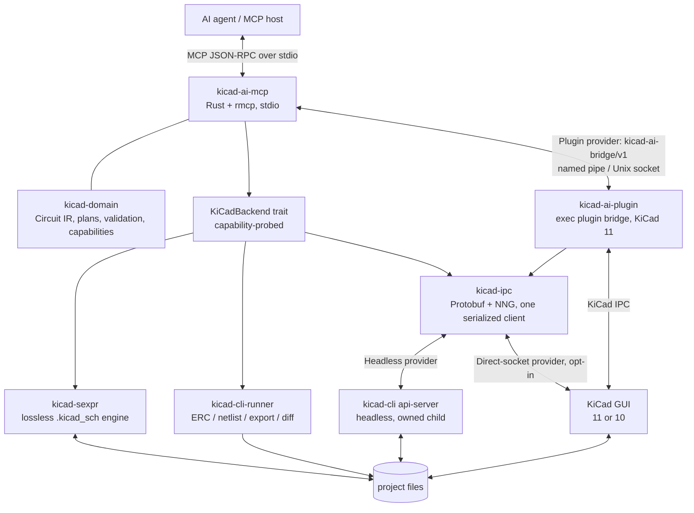

# KiCad AI MCP + Rust IPC Plugin
## Architecture, technical specification, and implementation plan for the first working version

**Document status:** Implementation plan (revision 2)  
**Prepared:** 23 October 2026 · **Revised:** 24 October 2026  
**Target:** KiCad 11 first-class (developed against pinned 10.99 nightly), KiCad 10.0.x fallback · Rust · Model Context Protocol (MCP)  
**First milestone:** A working Rust MCP server can inspect and modify a KiCad 11 schematic through the official IPC API (headless `kicad-cli api-server` and the live Schematic Editor), verify a small test circuit by read-back, and degrade to a documented, reduced capability set on KiCad 10.

### Revision 2 summary

| Change | Reason |
|---|---|
| KiCad 11 is the primary target; KiCad 10 is a supported fallback with a reduced capability set | KiCad 11 is not released yet (expected ~Q1 2027, not committed). The 10.99 nightly provides the schematic IPC API, headless `api-server`, and IPC jobs today. KiCad 10 has no schematic IPC commands. |
| Introduced a capability-probed `KiCadBackend` layer and three session providers (Headless, GUI-plugin, Direct-socket) | One set of MCP tool contracts across KiCad 10 and 11; the backend is chosen by runtime probing, never encoded in tool schemas. |
| Headless provider moved from "later" to the first IPC path | `kicad-cli api-server` is deterministic, needs no GUI plugin lifecycle, and is testable in CI. It removes plugin-lifetime risk from the critical path. |
| Windows is first-class from day one | Primary development machine is Windows 11; NNG `ipc://` maps to named pipes there. |
| Tools take explicit document targets; "active document" is an observation, not an implicit target | KiCad 10 has no typed active-document query; explicit targets are also safer with multiple open projects. |
| Result envelope gains `result_state` and `provenance` | A check that did not run is never reported as passing; every result states where its data came from (KiCad IPC, project file, CLI). |
| Added `kicad-sexpr` (file backend) and `kicad-cli` runner crates; added mock IPC server for tests | KiCad 10 fallback, offline verification, fixtures, and CI without a running KiCad. |
| Phase plan re-sequenced (§14) | Spike both versions first; v11 IPC path before v10 file fallback. |

---

## 1. Executive decision

Build the first version as separate layers with clear process boundaries:

1. **`kicad-ai-mcp`**: a Rust MCP server launched by an MCP host over stdio. It exposes validated, intent-oriented tools, selects a backend by capability probing, and owns the headless `kicad-cli api-server` child process when that provider is used.
2. **`kicad-ai-plugin` / bridge**: a Rust executable IPC plugin launched from KiCad 11's Schematic Editor (and PCB Editor). It receives the KiCad-provided socket and token, owns that GUI connection, and exposes a small local-only control endpoint to the MCP process. **KiCad 11 only** — KiCad 10 has no schematic plugin scope.
3. **`kicad-domain`**: a shared library containing the circuit intermediate representation, tool argument types, validation, layout rules, operation planning, and the capability model. It is a library, not a process, and has no KiCad transport types.

Supporting library crates: `kicad-ipc` (protobuf + NNG adapter), `kicad-sexpr` (lossless `.kicad_sch` engine for the KiCad 10 fallback and offline reads), `kicad-cli-runner` (ERC/export/diff jobs).

Core rules:

- The MCP server does not guess which KiCad instance to mutate. It either owns the instance (headless provider), receives it from KiCad (plugin bridge), or — only with explicit configuration — attaches to a discovered socket and pins the instance by token and open-document match.
- All requests to one KiCad instance are serialized through one IPC connection. KiCad handles API requests synchronously on its event loop; multiple connections give no throughput and risk ordering problems.
- Tool contracts never mention a backend. A result states its backend in `provenance`.

### First milestone boundaries

**Included**
- KiCad 11 (pinned nightly) schematic IPC: open/inspect a schematic, place library symbols, set fields, create wires and local labels, read the schematic netlist, save.
- Headless provider (`kicad-cli api-server`) as the first IPC path; GUI plugin bridge as the second.
- KiCad 10 fallback: read-only inspection via file parsing, ERC and netlist via `kicad-cli`, and — in a later phase of the milestone — file-based mutation of documents not open in an editor.
- Rust MCP server using the official Rust MCP SDK (`rmcp`) over stdio.
- Secure local bridge protocol (Windows named pipe first; Unix socket second).
- A deterministic two-resistor / three-net test schematic, verified on both KiCad versions.
- Integration tests, a mock IPC server for CI, and a repeatable local workflow.

**Not included in the first milestone**
- AI model hosting or orchestration.
- PCB layout, footprint placement, routing, manufacturing release.
- Part selection, distributor lookup, datasheet interpretation, simulation.
- Custom-symbol authoring, hierarchical generation, variants, buses, complex multi-unit symbols, placement optimization.
- Remote network access to the bridge.
- 3D enclosure design (suite roadmap; see §16.1).

---

## 2. KiCad API facts and version constraints

### 2.1 What each version provides (verified 24 Oct 2026)

| Capability | KiCad 10.0.x (stable) | KiCad 11 / 10.99 nightly |
|---|---|---|
| IPC plugin scopes | PCB Editor only | Schematic Editor and PCB Editor |
| Schematic IPC commands | None. `schematic_commands.proto` defines no messages; `schematic_types.proto` has 7 types (Line, Text, 4 label kinds) | `GetSchematicHierarchy`, `GetSchematicNetlist`, `PlaceSymbolFromLibrary`; ~44 schematic types (symbols, pins, fields, junctions, no-connects, sheets) |
| Generic editor commands for schematics | `GetOpenDocuments`, selection commands. No typed active-document query | Generic `CreateItems` / `UpdateItems` / `DeleteItems` / `GetItems` with schematic types, commit/undo |
| Jobs (ERC/export) over IPC | No; use `kicad-cli` | `schematic_jobs.proto`, `board_jobs.proto` |
| Headless | No | `kicad-cli api-server [--socket PATH] [PROJECT_OR_FILE]` |
| Other new protos | — | `library_commands`, `cross_probe_commands`, `variant_commands`, `schematic_rules` |
| SWIG `pcbnew` | Present, deprecated | Removed |
| `kicad-cli sch` | `erc`, `export {bom,dxf,hpgl,netlist,pdf,ps,python-bom,svg}`, `upgrade` | adds `diff` (JSON/text/PNG/SVG), `downgrade`, `import`, `export png` |
| Other `kicad-cli` | `fp`, `jobset`, `pcb`, `sch`, `sym`, `version` | adds `api-server`, `gerber`, `import`, `mergetool`, `project` |

The IPC protobuf API is stable under protobuf rules: existing messages and fields keep their meaning; new ones are added; deprecated items survive at least one major version. Practical consequence: **one generated proto set (from the pinned KiCad 11 commit) can talk to both versions**, with KiCad 10 answering newer requests with `AS_UNHANDLED` / `AS_UNIMPLEMENTED`. This must be confirmed in the Phase 0 spike.

`ApiRequestHeader.kicad_token` is optional. If a non-empty value is sent and does not match, KiCad rejects the request with `AS_TOKEN_MISMATCH`. Clients use it to pin a specific instance after the first reply.

### 2.2 Version policy

- **Tier 1 — KiCad 11.** Developed against a pinned nightly build until 11.0 is released, then pinned to 11.0.x. All MVP tools are implemented on the IPC backend.
- **Tier 2 — KiCad 10.0.x (≥ 10.0.7 tested).** Reduced capability set (§3.3). Must never be silently presented as equivalent to Tier 1; `kicad_status` reports the capability matrix.
- **Nightly drift.** Nightly protos can change. The pinned build hash, proto commit, and checksum are recorded in `docs/kicad-api-compatibility.md`. Updating the pinned nightly is a deliberate change with the Phase 0 probe suite re-run.
- **File formats.** KiCad 10 cannot open files written by KiCad 11 (newer `(version …)` token). The file backend must preserve a file's format version, refuse to write a version newer than it understands, and never upgrade a file implicitly. `kicad-cli sch downgrade` (11) exists but is out of scope for automatic use.

### 2.3 Development environment (validated 24 Oct 2026)

| Item | Value |
|---|---|
| OS | Windows 11 Pro 26H2 (build 26300), x64 |
| KiCad nightly | `10.99.0-5896-gd033635628`, built 23 Oct 2026, `D:\Program Files\KiCad\10.99` |
| KiCad stable | `10.0.7`, built 6 Oct 2026, `C:\Program Files\KiCad\10.0` |
| Environment | Machine-level `KICAD_HOME = D:\Program Files\KiCad\10.99`; `%KICAD_HOME%\bin` on machine `Path` (REG_EXPAND_SZ). Processes started before the change do not see it. |
| API server setting | 10.99: `api.enable_server = true`. 10.0: API server enabled by the user (24 Oct 2026). |
| User documents | `C:\Users\bkraj\OneDrive\Documents\KiCad\{10.0,10.99}` — OneDrive-redirected. Plugin directories live here; resolve the documents path at runtime, never hardcode it. |

The proto commit to vendor for Tier 1 is the nightly's git hash, `d033635628`.

### Official references
- KiCad IPC API: <https://dev-docs.kicad.org/en/apis-and-binding/ipc-api/>
- Add-on development, plugin manifest, environment variables: <https://dev-docs.kicad.org/en/apis-and-binding/ipc-api/for-addon-developers/>
- Schematic API reference (kicad-python, KiCad 11): <https://docs.kicad.org/kicad-python/schematic.html>
- KiCad source protos: <https://gitlab.com/kicad/code/kicad/-/tree/master/api/proto>
- Official KiCad Python IPC wrapper (reference for message usage): <https://gitlab.com/kicad/code/kicad-python>
- KiCad API plugin JSON Schema: <https://go.kicad.org/api/schemas/v1>
- Official Rust MCP SDK: <https://github.com/modelcontextprotocol/rust-sdk>

---

## 3. System architecture



### 3.1 Session providers

`KiCadSessionProvider` produces one serialized IPC session bound to one KiCad instance.

| Provider | KiCad | How the instance is chosen | Use |
|---|---|---|---|
| `HeadlessSessionProvider` | 11 | MCP spawns `kicad-cli api-server --socket <private path> <project>` with a fixed argument array; the socket path is in a private runtime directory | **First IPC path.** Deterministic automation, CI, and generation of designs not open in a GUI |
| `PluginSessionProvider` | 11 | The user clicks the Schematic/PCB Editor action; KiCad launches the bridge with `KICAD_API_SOCKET` and `KICAD_API_TOKEN` | Live co-editing with the user; changes appear in the editor with undo |
| `DirectSocketProvider` | 10 and 11 | Explicit configuration only. Attach to a configured or discovered socket, pin the instance token from the first reply, and require the target document in `GetOpenDocuments` | KiCad 10 GUI liveness/open-document checks and PCB work; KiCad 11 GUI without the plugin |

Rules:
- Never attach to a socket the current user does not own.
- Never open a raw stream connection to an NNG endpoint for discovery. A connection that does not complete the NNG handshake can wedge KiCad's server; Windows named pipes also consume a server instance.
- The headless child is owned by the MCP process: killed on MCP exit, deadline, or provider shutdown; never orphaned.
- Headless sessions do not preload libraries. Session start issues `LoadAllLibraries` (symbol type) and the session reports "libraries loading" until the libraries a plan needs are available; placement before that fails with `AS_BAD_REQUEST` ("symbol … not found"). In GUI sessions the command is a no-op.
- One provider per target document at a time. A document open in a GUI must not also be mutated through a headless server or the file backend.

### 3.2 Backends and capability model

```text
trait KiCadBackend {
    fn capabilities(&self) -> &CapabilitySet;   // probed, not assumed
    // read, plan-apply, netlist, erc, export … each gated by a capability
}
```

| Backend | KiCad | Provides |
|---|---|---|
| `IpcSchematicBackend` | 11 | Schematic read/mutate, hierarchy, netlist, save, IPC jobs |
| `IpcCoreBackend` | 10, 11 | Version, open documents, save/revert, selection; PCB read/mutate (later) |
| `SchFileBackend` (`kicad-sexpr`) | 10, 11 | Schematic read from saved files; on KiCad 10, guarded mutation of documents not open in an editor |
| `CliBackend` | 10, 11 | ERC (`--format json`), netlist, SVG/PDF/PNG/BOM export, `sch diff` (11) |

Capabilities are probed at session start (`GetVersion`, then a harmless request per capability family; `AS_UNHANDLED` / `AS_UNIMPLEMENTED` → unsupported). Selection order per operation: IPC → CLI → file. A fallback is used only when the preferred backend is **unavailable**. If KiCad answered and rejected a request, the operation stops and reports the KiCad error; it never retries through another backend.

### 3.3 Capability matrix (MVP target)

| Capability | KiCad 11 | KiCad 10 |
|---|---|---|
| `session.status`, `session.open_documents` | IPC | IPC (GUI, API server enabled) |
| `sch.read_symbols`, `sch.read_pins`, `sch.read_labels` | IPC | File (saved state only) |
| `sch.netlist` | IPC (`GetSchematicNetlist`) | CLI (`sch export netlist`) |
| `sch.place_symbol`, `sch.add_wire`, `sch.add_label`, `sch.set_field` | IPC | File, only if the document is not open in any editor (later phase) |
| `sch.save` | IPC | File writer (atomic) |
| `sch.erc` | IPC job or CLI | CLI |
| `sch.render` | IPC job or CLI | CLI (SVG/PDF) |
| `sch.diff` | CLI | Unavailable |
| Live co-editing with undo | Plugin provider | Unavailable |

### 3.4 Process ownership

| Component | Process model | Responsibility | Must not do |
|---|---|---|---|
| MCP server | One process per MCP host session | Tools, validation, policy, plans, backend selection, owning the headless child | Write non-protocol text to stdout; attach to unowned sockets; fall back after a KiCad rejection |
| Headless API server | Child of the MCP server | Load the target project, serve IPC | Outlive the MCP process; listen on a non-private path |
| Plugin / bridge | Launched by a KiCad 11 editor action | Hold the KiCad-provided connection, serialize requests, serve the local endpoint | Expose TCP; log the token; allow overlapping mutations |
| `kicad-ipc` | Library | Envelope/protobuf, NNG, deadlines, status mapping | Leak protobuf types to MCP/domain |
| `kicad-sexpr` | Library | Lossless parse/serialize, UUID preservation, atomic write, revision checks | Write a file open in an editor; change the format version |
| `kicad-cli-runner` | Short-lived children | ERC/export/diff with fixed argument arrays, JSON reports | Use a shell; treat exit 0 as functional correctness |
| `kicad-domain` | Library | IR, plans, validation, capabilities | Depend on transport or UI state |

---

## 4. Repository layout

Single Cargo workspace. No microservices or containers until the core works.

```text
thingsvu-tools/
├── Cargo.toml
├── Cargo.lock
├── rust-toolchain.toml
├── docs/
│   ├── kicad-ai-mcp-design-plan.md
│   ├── kicad-api-compatibility.md      # pinned builds, proto commit, probe results
│   └── tool-contracts.md
├── examples/
│   ├── two-resistor-series-chain.json
│   └── mcp-client-config.example.json
├── plugin-package/
│   ├── plugin.json                      # KiCad 11 manifest (schematic + pcb scopes)
│   └── README.md
├── crates/
│   ├── kicad-ai-mcp/                    # bin: MCP stdio server
│   │   └── src/{main,server,tools,backend_select,headless,bridge_client,logging}.rs
│   ├── kicad-ai-plugin/                 # bin: KiCad 11 exec plugin / bridge
│   │   └── src/{main,lifecycle,local_server,config}.rs
│   ├── kicad-domain/                    # lib: IR, plans, validation, capabilities
│   │   └── src/{lib,circuit,geometry,operations,validation,ids,capabilities,result}.rs
│   ├── kicad-ipc/                       # lib: protobuf + NNG adapter
│   │   ├── build.rs
│   │   ├── proto/                       # vendored from KiCad commit d033635628
│   │   └── src/{lib,connection,envelope,errors,probe,schematic,core}.rs
│   ├── kicad-sexpr/                     # lib: lossless .kicad_sch engine
│   │   └── src/{lib,parse,write,schematic,atomic,lock}.rs
│   ├── kicad-cli-runner/                # lib: kicad-cli jobs and report parsing
│   │   └── src/{lib,install,erc,netlist,export,diff}.rs
│   └── kicad-ipc-mock/                  # dev lib: inproc NNG responder for tests
├── tests/
│   ├── fixtures/{v10,v11}/              # KiCad-authored files per version
│   ├── mcp_protocol.rs
│   ├── bridge_protocol.rs
│   ├── backend_contract.rs              # same assertions on every backend
│   └── live_kicad_smoke.rs              # #[ignore] unless KICAD_LIVE=1
└── scripts/
    ├── install-plugin.ps1
    ├── uninstall-plugin.ps1
    ├── probe-kicad.ps1                  # Phase 0 capability probe
    └── run-live-smoke-test.ps1
```

Shell (`.sh`) equivalents are added when Linux/macOS are supported.

**License:** the project is licensed GPL-3.0-or-later, matching KiCad and its `.proto` files. Vendored protos keep their original headers; third-party dependencies must be GPL-3.0-compatible (checked with `cargo deny`).

---

## 5. Technology specification

### 5.1 Rust and workspace
- Stable Rust pinned in `rust-toolchain.toml`; `Cargo.lock` committed.
- `tokio`, `serde`/`serde_json`, `tracing`/`tracing-subscriber`, `thiserror` (libraries), `anyhow` (binaries only).
- `rmcp` (official Rust MCP SDK), exact version pinned. Use structured tool output (`structuredContent` + `outputSchema`) where the pinned release supports it.
- `schemars` (or the rmcp-integrated equivalent) to generate tool input schemas from Rust types.

### 5.2 KiCad IPC adapter (`kicad-ipc`)
- `prost` / `prost-build` code generated from the vendored protos. Record commit and SHA-256 per file.
- NNG via a maintained Rust binding (`nng` crate) or direct FFI. Prove request/reply, deadlines, and Windows named-pipe addressing in the Phase 0 spike.
- Typed envelope with `client_name` (`thingsvu-kicad-ai-<pid>`) and pinned `kicad_token` after the first reply.
- Map every `ApiStatusCode` to a typed error: `AS_BUSY`/`AS_NOT_READY` → retryable; `AS_UNHANDLED`/`AS_UNIMPLEMENTED` → `FEATURE_UNAVAILABLE`; `AS_TOKEN_MISMATCH` → `KICAD_INSTANCE_CHANGED`; `AS_BAD_REQUEST` → non-retryable.
- One serialized request channel per session with a bounded queue; a deadline on every request; no blind retries of mutations.
- Unit conversion (mm ↔ KiCad internal units) lives only here; the pinned proto definitions are the authority on units.
- Protobuf `Any` payloads are dispatched by full type URL. Unknown types are an error, never decoded as empty.

### 5.3 File backend (`kicad-sexpr`)
- Lossless concrete syntax tree: untouched nodes, ordering, and formatting survive a round trip byte-for-byte where KiCad's writer would also keep them.
- UUIDs preserved; new objects get v4 UUIDs. File UUIDs are the same KIIDs the IPC API returns, so object identities survive a backend switch.
- Atomic write: temp file in the same directory → flush/fsync → rename. Capture a content hash at read; refuse to write if the file changed since (`FILE_CHANGED_ON_DISK`).
- Refuse mutation if the document is open in any editor: KiCad lock file (`~<name>.kicad_sch.lck`), `GetOpenDocuments` on any reachable instance, or a headless session holding it.
- Preserve the file's `(version …)`; refuse unknown newer versions.
- Validate every write by re-parsing and running `kicad-cli sch erc` / `sch export netlist` on the result.

### 5.4 CLI runner (`kicad-cli-runner`)
- Discover installs from configuration first, then `KICAD_HOME`, then standard install directories. Each install records its `kicad-cli version` output. Pair the CLI with the KiCad version of the target session; never run the 10.0 CLI on a file written by 11.
- Fixed argument arrays via `std::process::Command`; no shell.
- Prefer machine-readable output (`sch erc --format json`, `sch diff` JSON on 11). Capture exit code, stdout, stderr, and report path separately.
- Version-specific argument tables live here (flags change between majors).

### 5.5 MCP server
- Transport: stdio. All diagnostics on stderr or a private log file.
- Register only implemented and tested tools. Tools whose capability is unavailable on the current session are still listed but return `FEATURE_UNAVAILABLE` with the feature name, so agent behavior does not depend on hidden tools.
- JSON Schema (Draft 2020-12) for every input, enforced at dispatch; domain validation still runs in handlers.
- Stable error codes: `NO_SESSION`, `BRIDGE_DISCONNECTED`, `KICAD_BUSY`, `KICAD_INSTANCE_CHANGED`, `FEATURE_UNAVAILABLE`, `DOCUMENT_NOT_OPEN`, `DOCUMENT_OPEN_ELSEWHERE`, `FILE_CHANGED_ON_DISK`, `STALE_PLAN`, `SYMBOL_NOT_FOUND`, `INVALID_GRID_COORDINATE`, `INVALID_ARGUMENT`, `AMBIGUOUS_TIMEOUT`, `ERC_UNAVAILABLE`, `READ_ONLY_MODE`.
- Group tools by prefix (`session_`, `sch_`, later `pcb_`, `lib_`, `mech_`) so tool groups can be enabled on demand later via `notifications/tools/list_changed`. Do not hide tools behind a generic `execute_tool` proxy.

### 5.6 Local bridge transport (`kicad-ai-bridge/v1`)
- **Windows named pipe first** (`\\.\pipe\thingsvu-kicad-ai-<user-sid-hash>-<session>`), created with a security descriptor restricting access to the current user. Unix domain socket in a `0700` runtime directory with a `0600` socket on Linux/macOS.
- No TCP listener.
- Newline-delimited JSON; every message has `protocol_version`, `request_id`, `operation`, `payload`; every reply has `request_id`, `ok`, and `result` or a typed `error`.
- Frame size limits; reject malformed JSON and unknown protocol versions.
- The bridge advertises its session (KiCad version, capability set, open documents, non-secret instance fingerprint) through a discovery file in the private runtime directory; the MCP server reads it rather than scanning pipes.
- Never include `KICAD_API_TOKEN` in replies or logs.

---

## 6. Executable plugin specification (KiCad 11)

### 6.1 Actions
- **Start / reconnect AI bridge** (`start-ai-bridge`), scopes `schematic` and `pcb`.
- **Stop AI bridge** (`stop-ai-bridge`) after lifecycle behavior is validated; sends a local shutdown request rather than killing processes by name.

Whether KiCad keeps a long-running executable action alive must be tested on the pinned nightly. If not, the action is a launcher that starts a managed bridge process and returns. The bridge exits when its KiCad connection closes.

### 6.2 Manifest
See `plugin.json.example`. KiCad 10 does not support the `schematic` scope; the plugin package targets KiCad 11 only and is installed into the version-specific plugin directory (`<KiCad documents>\10.99\plugins` for the nightly — on this machine under OneDrive). Validate the manifest against the schema shipped with the pinned build.

### 6.3 Startup behavior
1. Read `KICAD_API_SOCKET` and `KICAD_API_TOKEN`; fail fast if missing.
2. Connect, `GetVersion`, probe capabilities.
3. Record a non-secret fingerprint, KiCad version, and PID.
4. Create the private local endpoint and discovery file.
5. Serve requests serially.
6. On connection loss or `AS_TOKEN_MISMATCH`, transition to `DISCONNECTED`; require reconnect.
7. On stop request or KiCad exit, shut down and remove only its own endpoint and discovery file.

### 6.4 User experience
- Report startup failures through stdout/stderr (KiCad 10.0.1+ shows executable-plugin console output in its warning-message system; confirm on 11) and the bridge log.
- Never show modal UI on the request path.
- Batch related mutations into one commit so a tool call is one undo step.
- Never write outside the project directory unless the user supplied the destination.

---

## 7. MCP tool design

### 7.1 First tool set

All document-targeting tools take an explicit `project` (path to `.kicad_pro`) and, where relevant, `schematic` (project-relative `.kicad_sch` path) and `sheet_path`.

| Tool | Capability | Purpose |
|---|---|---|
| `session_status` | `session.status` | Providers, sessions, KiCad versions, capability matrix, read-only mode |
| `session_open` | — | Open a target project with a chosen or automatic provider (`headless`, `plugin`, `direct`, `file`); returns a session ID |
| `session_list_documents` | `session.open_documents` | Open documents per session (observation; includes GUI-active info when KiCad exposes it) |
| `sch_list_symbols` | `sch.read_symbols` | UUID, reference, value, library ID, position (mm), sheet path, with `provenance` |
| `sch_get_symbol_pins` | `sch.read_pins` | Pin number/name/type and world position for one symbol (UUID or unambiguous reference) |
| `sch_get_netlist` | `sch.netlist` | Nets with connected (symbol UUID, reference, pin) tuples |
| `sch_plan_changes` | — | Validate a `CircuitSpec` or operation list against a snapshot; returns plan ID, operations, warnings |
| `sch_apply_plan` | `sch.place_symbol` etc. | Apply a plan with `confirm: true`; one commit; returns created IDs and read-back verification |
| `sch_save` | `sch.save` | Save the target schematic |
| `sch_run_erc` | `sch.erc` | ERC with parsed findings and report path |
| `sch_export_netlist` | `sch.netlist` | Export to a project-relative path |
| `sch_render` | `sch.render` | SVG/PNG snapshot for visual inspection |
| `sch_create_demo_circuit` | via plan | The two-resistor fixture as plan → apply → verify |

Later: `sch_move_symbol`, `sch_set_field`, `sch_add_power_symbol`, `sch_remove_item`, `sch_diff`, `session_get_installation_info`.

### 7.2 Tool design rules
1. Stable IDs (KIIDs/UUIDs) internally; references are display values.
2. Pins by symbol identity plus pin number; never infer from ambiguous names.
3. Plan and apply are separate. A plan records session, document identity, and a document revision/hash; it is `STALE_PLAN` if any change.
4. Idempotency key on every apply; a repeated key returns the earlier result.
5. Success is derived from read-back, never from the request echo.
6. Prefer high-level batches; one apply = one KiCad commit = one undo step (IPC).
7. Bound counts, coordinates, payload sizes, and durations.
8. Return changed IDs and a diff summary.
9. Same contract on every backend; tests in `backend_contract.rs` run identical assertions on IPC and file backends.

### 7.3 Example argument schemas

`sch_apply_plan`:

```json
{
  "type": "object",
  "required": ["session_id", "plan_id", "confirm", "idempotency_key"],
  "properties": {
    "session_id": {"type": "string", "maxLength": 64},
    "plan_id": {"type": "string", "maxLength": 64},
    "confirm": {"const": true},
    "idempotency_key": {"type": "string", "minLength": 8, "maxLength": 128}
  },
  "additionalProperties": false
}
```

Operation (inside a plan), `add_wire`:

```json
{
  "type": "object",
  "required": ["op", "start_mm", "end_mm"],
  "properties": {
    "op": {"const": "add_wire"},
    "start_mm": {"$ref": "#/$defs/point_mm"},
    "end_mm": {"$ref": "#/$defs/point_mm"},
    "sheet_path": {"type": "string", "maxLength": 512}
  },
  "additionalProperties": false
}
```

Public coordinates are millimetres; endpoints must be on the connection grid with non-zero length.

### 7.4 Result envelope

```json
{
  "ok": true,
  "result_state": "done",
  "result": { "...": "tool-specific" },
  "provenance": [
    {"origin": "kicad_ipc", "kicad_version": "10.99.0-5896-gd033635628", "provider": "headless", "document": "demo.kicad_sch", "revision": "sha256:…"}
  ],
  "warnings": [],
  "correlation_id": "req-000042"
}
```

`result_state` is one of:

| State | Meaning |
|---|---|
| `done` | Operation and its verification finished |
| `partial` | Lists applied, failed, and not-attempted items |
| `rejected` | Nothing was applied; the error explains why |
| `unknown` | A change may have been applied; read back before retrying |
| `not_run` | A required check or feature could not run; never reported as a pass or as zero findings |

Error example:

```json
{
  "ok": false,
  "result_state": "unknown",
  "error": {
    "code": "AMBIGUOUS_TIMEOUT",
    "message": "KiCad did not reply before the deadline after the commit was sent.",
    "retryable": false,
    "mutation_state": "unknown",
    "correlation_id": "req-000042"
  }
}
```

`provenance.origin` is one of `kicad_ipc`, `project_file`, `kicad_cli`. A result combining sources lists each.

---

## 8. Domain model and coordinate/connectivity rules

### 8.1 Initial domain types
- `CircuitSpec`, `ComponentSpec` (logical ID, library ID, reference preference, value, fields, optional footprint and MPN/LCSC fields for later part tooling), `PinRef`, `NetSpec`.
- `OperationPlan`: ordered operations with preconditions, expected effects, document revision, and reconciliation notes.
- `DocumentSnapshot`: identity, revision/hash, symbols, pins, wires, labels.
- `CapabilitySet`: probed capabilities per session.
- `ResultState` and `Provenance`.
- `ValidationFinding`: severity, code, affected objects, explanation, suggested next step.

Never use `R1` as the sole identity of a component.

### 8.2 Grid and geometry
- Public coordinates in mm; the standard connection grid is 50 mil (1.27 mm).
- Snap or reject off-grid endpoints with an actionable error.
- Pin world positions: on KiCad 11, read from IPC; on the file backend, compute from library-local pin positions plus the symbol transform (rotation, mirror). Both paths share one transform implementation in `kicad-domain`, cross-checked against IPC read-back in tests.
- Re-read connectivity after wiring; geometry is not proof of connection.
- Deterministic simple grid layout for the MVP.

### 8.3 Electrical intent vs graphical layout
A circuit says `R1.2` and `R2.1` are on `MID`; the layout engine chooses coordinates; the backend creates wires and labels.

---

## 9. First working circuit and end-to-end behavior

```text
INPUT ── R1 (10 kΩ) ── MID ── R2 (10 kΩ) ── OUTPUT
```

`Device:R` symbols; `INPUT`, `MID`, `OUTPUT` local labels; 1.27 mm grid. Fixture: `examples/two-resistor-series-chain.json`.

### Expected agent/tool sequence (KiCad 11, headless)
1. `session_status` → KiCad 11 available, headless provider, capability matrix.
2. `session_open` with the disposable test project, provider `headless`.
3. `sch_create_demo_circuit` in plan mode → plan ID and operations.
4. `sch_apply_plan` with `confirm: true` and an idempotency key → one commit.
5. Read-back of symbols and `GetSchematicNetlist`.
6. `sch_save`, `sch_export_netlist`, `sch_run_erc`.
7. Test compares the exported netlist graph to the fixture.

### KiCad 10 fallback sequence
Same tool calls with `session_open` provider `file` on a project not open in any editor. Mutation goes through `kicad-sexpr`; netlist and ERC through the 10.0 `kicad-cli`. `provenance.origin` is `project_file` / `kicad_cli`.

### Acceptance criteria

**KiCad 11 (Tier 1)**
- [ ] Headless provider starts, connects, probes, and stops cleanly; no orphan process after MCP exit or kill.
- [ ] `session_status` succeeds through a real MCP client over stdio; no non-protocol stdout.
- [ ] Symbol inventory matches an existing KiCad-authored fixture.
- [ ] Demo circuit is created through IPC in one commit; read-back verifies values, references, labels, and topology.
- [ ] Retrying an apply with the same idempotency key creates no duplicates.
- [ ] A timeout after a commit returns `unknown` and is reconciled by read-back, not blind retry.
- [ ] Saved project reopens in the KiCad 11 GUI without a repair prompt.
- [ ] Plugin provider: the Schematic Editor action appears, connects to the right instance, and the same demo works live with one undo step.
- [ ] Closing/restarting KiCad yields `BRIDGE_DISCONNECTED` / `NO_SESSION`, never a hung tool call.
- [ ] Logs contain no API token.

**KiCad 10 (Tier 2)**
- [ ] `session_status` reports KiCad 10 with the reduced capability matrix.
- [ ] Read tools work on saved files with `provenance.origin = project_file`.
- [ ] ERC and netlist run through the 10.0 `kicad-cli` and are parsed.
- [ ] Mutation is refused with `DOCUMENT_OPEN_ELSEWHERE` while the schematic is open in KiCad 10.
- [ ] Demo circuit via the file backend: the result opens in KiCad 10.0.7 without a repair prompt, and its netlist matches the fixture.
- [ ] Byte-level round trip of unmodified KiCad-authored fixtures.

---

## 10. Request sequencing, timeouts, and recovery

```text
MCP tool call
  -> schema + domain validation
  -> plan (snapshot + revision)
  -> backend selection by capability
  -> bounded per-session queue
  -> single IPC client / file transaction / CLI job
  -> typed result or typed error
  -> read-back and reconciliation for mutations
```

| Operation | Retry policy |
|---|---|
| Read-only | Bounded retry on `AS_BUSY` / `AS_NOT_READY` |
| Save / export | Retry only after checking document/job state |
| Create / update / delete | Never blindly retried; read back and reconcile using idempotency key and expected object IDs |
| CLI job | Deadline; separate stdout/stderr; parse report when present |
| Headless server start | Deadline for readiness; kill and report on failure |

Starting values (configurable; record observed behavior per build): bridge request 10 s; busy backoff 200 ms / 500 ms / 1 s; tool max 30 s (export/ERC longer); max 50 operations and 200 wire segments per plan.

Plans are bound to session, document identity, and revision; any mismatch returns `STALE_PLAN`.

---

## 11. Validation strategy

1. Tool-input validation (schema, identifiers, ranges, sizes).
2. Domain validation (duplicate IDs, reference collisions, pin refs, zero-length wires, undefined net members).
3. Geometry validation (grid, transforms, deterministic routing).
4. IPC status validation.
5. Read-back validation (symbols and netlist after apply).
6. ERC (IPC job or `kicad-cli sch erc --format json`).
7. Export validation (parse exported netlist; compare to intent).
8. Reopen validation in the GUI of the same KiCad version.
9. Cross-version check: a file written by the KiCad 10 path opens in KiCad 10.0.7; a file written by KiCad 11 is never handed to the KiCad 10 path.
10. Electrical/design validation: later phase. Zero ERC errors is not proof of correctness.

### Testing levels
- **Unit:** snapping, transforms, reference allocation, schema validation, plan staleness, error mapping, capability selection.
- **Protocol:** envelope encode/decode against `kicad-ipc-mock` (inproc NNG), status-code mapping, token redaction, bridge framing.
- **File backend:** round trip of KiCad-authored fixtures (v10 and v11), atomic write, stale-target refusal, lock refusal.
- **MCP:** tool listing, invalid inputs, structured results, stdio purity, disconnect handling.
- **Backend contract:** identical assertions on IPC and file backends for the demo circuit.
- **Live integration** (`KICAD_LIVE=1`, serial): pinned nightly headless and GUI; KiCad 10.0.7 GUI and CLI.
- **Failure injection:** kill KiCad during read/mutation; malformed bridge message; second KiCad instance; token mismatch; duplicate apply; file changed between plan and apply.
- **Guard-removal tests:** for each safety guard, a test that is shown to fail when the guard is disabled.

CI: unit/protocol/file/MCP tests on every push (Windows runner first). Live tests on the developer workstation; later on CI using official KiCad Docker images (stable and nightly) for CLI and headless jobs.

---

## 12. Security and operational requirements

- Local-only bridge: named pipe / Unix socket with current-user access only; no TCP.
- Headless API server socket in a private runtime directory.
- Never log `KICAD_API_TOKEN` or full envelopes; redact by default.
- Treat all LLM-supplied values, paths, labels, and net names as untrusted.
- Output paths restricted to the project directory unless explicitly allowed.
- No shell: fixed executables and argument arrays only.
- Size and count limits on all inputs.
- Operation log: correlation ID, tool, target document, changed objects, result state, data origin; no tokens or unnecessary design content.
- `read_only` mode rejects all mutation tools.
- Explicit apply step required; destructive operations and overwrites out of scope for the MVP.
- IPC trace logs (`KICAD_ENABLE_WXTRACE=1`, `WXTRACE=KICAD_API`, `EnableAPILogging=1`) contain design data; enable only while debugging.

---

## 13. Build and installation workflow

### Prerequisites
- KiCad nightly (pinned build, §2.3) with API server enabled; KiCad 10.0.7 with API server enabled for Tier 2 IPC probes.
- Stable Rust; `protoc`; NNG (built by the binding crate or provided).
- An MCP host that launches a stdio server (Claude Code / Claude Desktop / VS Code).

### Install selection
Configuration file lists KiCad installs explicitly. Defaults on this machine:

```toml
[[kicad.install]]
name = "nightly"
cli  = 'D:\Program Files\KiCad\10.99\bin\kicad-cli.exe'
tier = 1

[[kicad.install]]
name = "stable"
cli  = 'C:\Program Files\KiCad\10.0\bin\kicad-cli.exe'
tier = 2
```

If no file exists: `KICAD_HOME`, then standard install directories. `session_status` reports which install was selected and why.

### Local test loop
1. `cargo build`.
2. `scripts\install-plugin.ps1` (KiCad 11 plugin directory only).
3. Headless path: run the MCP server, `session_open` with provider `headless` on a disposable project.
4. GUI path: open the disposable project in the nightly, click **Start / reconnect AI bridge**, `session_open` with provider `plugin`.
5. Tier 2: close KiCad 10, `session_open` with provider `file`.
6. Run `cargo test`, then live tests with `KICAD_LIVE=1`.

### Logging
- MCP protocol on stdout only; logs to stderr and a private rotating file.
- Separate MCP, bridge, and headless-server logs, joined by correlation ID.

---

## 14. Delivery plan

Sequenced by risk. One developer.

### Phase 0 — Compatibility spike (both versions)
**Deliverable:** `scripts\probe-kicad.ps1` plus a Rust probe binary, and `docs/kicad-api-compatibility.md` filled with observed results.

Probe matrix:

| Probe | Nightly headless | Nightly GUI | 10.0.7 GUI |
|---|---|---|---|
| Endpoint addressing on Windows (named pipe naming with `--socket`; default socket) | ✓ | ✓ | ✓ |
| NNG handshake, `GetVersion`, `Ping` | ✓ | ✓ | ✓ |
| Token: empty token accepted; pinned token; mismatch error | ✓ | ✓ | ✓ |
| `GetOpenDocuments` (schematic, PCB) | ✓ | ✓ | ✓ |
| Open a project/schematic in headless | ✓ | — | — |
| `GetSchematicHierarchy`, `GetSchematicNetlist` | ✓ | ✓ | expect `AS_UNHANDLED` |
| `PlaceSymbolFromLibrary` (incl. library loading in headless) | ✓ | ✓ | expect unsupported |
| `CreateItems` wire + local label; `BeginCommit`/`EndCommit` | ✓ | ✓ | expect unsupported |
| `SaveDocument`; `RevertDocument` | ✓ | ✓ | ✓ (record whether eeschema 10 answers) |
| Schematic job (ERC/export) over IPC | ✓ | ✓ | — |
| Generated v11 protos decode KiCad 10 replies | — | — | ✓ |
| Executable plugin action lifetime (schematic scope) | — | ✓ | — |

Exit criteria: every row recorded as supported / unsupported / failing, with captured request/response logs; proto commit and checksums recorded; license confirmed as GPL-3.0-or-later. **Do not proceed** to Phase 2 until the headless column passes.

First results (24 Oct 2026, nightly headless, default socket): NNG handshake, `GetVersion`, and `Ping` succeed over the named pipe `\\.\pipe\<socket path>`; the pipe does not appear in a pipe-namespace listing, so discovery derives the name from the socket path. Document commands return `AS_UNHANDLED` when the server has no loaded project. Next: repeat with a pre-loaded project and with `--socket`.

### Phase 1 — Foundations
`kicad-domain` (IR, plans, result states, capabilities), `kicad-ipc` (envelope, status mapping, serialized client), `kicad-ipc-mock`, `kicad-cli-runner` (install discovery, ERC JSON, netlist). Headless provider lifecycle. MCP skeleton with `session_status` and `session_open`.

Exit: unit and protocol tests green on Windows CI; `session_status` from a real MCP host against the nightly headless server.

### Phase 2 — KiCad 11 read path
`sch_list_symbols`, `sch_get_symbol_pins`, `sch_get_netlist`, `session_list_documents` on IPC. Results agree with KiCad-authored fixtures.

### Phase 3 — KiCad 11 mutation path (headless)
Plan/apply, symbol placement, fields, wires, labels, one commit per apply, read-back, save, ERC, netlist export, `sch_render`. Two-resistor demo end-to-end.

Exit: all Tier 1 headless acceptance criteria.

### Phase 4 — KiCad 11 GUI plugin provider
`kicad-ai-plugin`, `kicad-ai-bridge/v1` over named pipe, discovery file, start/stop, reconnect. Same demo live in the Schematic Editor with undo.

Exit: all Tier 1 acceptance criteria.

### Phase 5 — KiCad 10 fallback
`kicad-sexpr` read path, then guarded mutation for closed documents; CLI-based ERC/netlist with the 10.0 CLI; direct-socket provider for open-document checks. Backend-contract tests run the demo on both backends.

Exit: all Tier 2 acceptance criteria.

### Phase 6 — Hardening and packaging
PCM package and PowerShell installer, read-only mode, log rotation, failure-injection suite, documentation of the observed capability matrix. Re-pin to KiCad 11.0 when released and re-run the Phase 0 probes.

### Later
PCB tools on IPC (both versions), hierarchical sheets, layout engine improvements, BOM/part tooling, design-review checks, simulation hand-off, MCP prompts/resources and a bundled skill with KiCad conventions, on-demand tool groups, enclosure integration (§16.1).

---

## 15. Risks and mitigations

| Risk | Impact | Mitigation |
|---|---|---|
| Nightly API changes before 11.0 | Rework, broken probes | Pin build + proto commit; probe suite re-run on every re-pin; adapter isolation |
| KiCad 11 release slips | Tier 1 users must run nightly | Tier 2 fallback provides read/ERC/netlist and closed-file mutation on 10 |
| Headless API server endpoint/lifecycle differs from docs | Blocks first IPC path | Phase 0 first; plugin provider as alternative path |
| Rust NNG binding issues on Windows named pipes | Blocks IPC | Spike first; FFI fallback; isolate behind a trait |
| Plugin process lifetime doesn't fit a persistent bridge | Bridge exits early | Launcher + managed child; headless path doesn't depend on it |
| File backend corrupts or upgrades a file | Data loss, unreadable in KiCad 10 | Lossless CST, round-trip fixtures, version preservation, atomic writes, CLI validation after write |
| Same document mutated via two paths (GUI + file/headless) | Lost edits on next GUI save | Lock-file and open-document checks; one provider per document |
| Connected-looking geometry differs from netlist | Wrong circuit | Grid snap; IPC or computed pin positions; netlist read-back |
| Retry duplicates objects | Corrupt schematic | Idempotency keys; read-back reconciliation |
| User switches document between plan and apply | Wrong target | Explicit targets; revision-bound plans |
| Too many low-level tools | Poor agent behavior | High-level batches; prefixed tool groups |
| Logs leak token or design IP | Security incident | Redaction, private paths, rotation |
| Modal GUI state blocks IPC | Timeouts | Deadlines, typed errors, no modal UI in bridge |
| OneDrive-redirected documents folder | Sync interference with plugin binaries/locks | Resolve path at runtime; document; allow plugin install path override |

---

## 16. Definition of done for the first release

From a clean checkout on Windows 11:

1. Build with locked dependencies.
2. **KiCad 11 headless:** MCP host launches `kicad-ai-mcp`; agent creates the two-resistor demo through plan/apply; save, netlist, ERC; netlist matches the fixture; file reopens in the nightly GUI.
3. **KiCad 11 GUI:** install the plugin, open the project, start the bridge, repeat the demo live; one undo step reverts it.
4. **KiCad 10 fallback:** with KiCad 10.0.7, the same agent request produces a correct schematic via the file backend on a closed project, and the result opens in KiCad 10.0.7.
5. Close KiCad mid-session: tools report a clean disconnected error; reconnect and repeat.
6. `session_status` truthfully reports provider, version, and capability matrix in every case.

Do not market the result as an autonomous electrical engineer until electrical validation and simulation exist.

### 16.1 Suite roadmap note (enclosure design)
Keep `kicad-domain` KiCad-specific. When the mechanical/enclosure tools start, define a neutral exchange model (board outline, mounting holes, keep-outs, connector positions and orientations, component heights, STEP via `kicad-cli pcb export step`) in its own crate, consumed by both the KiCad and enclosure tool servers.

---

## Appendix A: Stable names

- Workspace: `thingsvu-tools`
- MCP binary: `kicad-ai-mcp`
- Plugin/bridge binary: `kicad-ai-plugin`
- Bridge protocol: `kicad-ai-bridge/v1`
- Crates: `kicad-domain`, `kicad-ipc`, `kicad-sexpr`, `kicad-cli-runner`, `kicad-ipc-mock`
- First composite tool: `sch_create_demo_circuit`
- First fixture: `two_resistor_series_chain`

Tool and protocol names are versioned once published.

## Appendix B: Source checklist

1. KiCad IPC API — <https://dev-docs.kicad.org/en/apis-and-binding/ipc-api/>
2. Add-on developer guide — <https://dev-docs.kicad.org/en/apis-and-binding/ipc-api/for-addon-developers/>
3. Schematic API reference (KiCad 11) — <https://docs.kicad.org/kicad-python/schematic.html>
4. KiCad protos at the pinned commit — <https://gitlab.com/kicad/code/kicad/-/tree/d033635628/api/proto>
5. Plugin schema — <https://go.kicad.org/api/schemas/v1>
6. kicad-python source — <https://gitlab.com/kicad/code/kicad-python>
7. Rust MCP SDK — <https://github.com/modelcontextprotocol/rust-sdk>

---

**End of document.**
