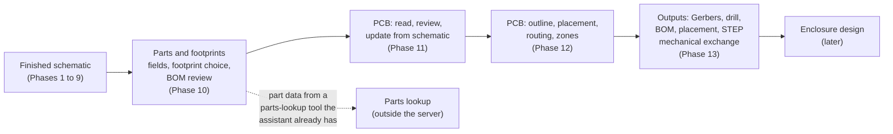

# Plan: parts, footprints, BOM, and PCB tools

Status: Phases 10 (v0.5.0) and 11 (v0.6.0) **done**; Phases 12 and 13 planned, not started (written 25 Oct 2026, after Phase 9). The task lists are in [tasks.md](tasks.md), Phases 10 to 13. This page holds the reasoning: what we are building, what KiCad lets us do, what we will not do, and the decisions that need the project owner's review.

## Goal

An assistant should be able to take a finished schematic to a board that can be sent to a manufacturer, with the same guarantees the schematic tools already give: nothing changes before the user confirms, every change is checked against KiCad afterwards, and a live editor change is undoable.

The path, and the phase that opens each step:

## What we know about KiCad (to be confirmed by the Phase 10 and 11 probes)

| Topic | From the API protos and `kicad-cli` (not yet probed here) | Consequence |
|---|---|---|
| Board editing over the API | `CreateItems` / `UpdateItems` / `DeleteItems` for tracks, vias, zones, graphics, text; `PlaceFootprintFromLibrary` and `GetBoardBoundingBox` (both marked **Since 11.0**); `FlipItems`; `GetNets`, `GetItemsByNet`, `GetConnectedItems`; board stackup, layers, design rules, custom rules (`GetBoardDesignRules`, `GetCustomDesignRules`) | KiCad 11 is first-class for PCB, as for schematics. Same plan, confirm, apply, verify flow |
| Updating the board from the schematic | `ImportNetlist` with `dry_run`, match by reference or UUID, optional delete of extra footprints | `pcb_update_from_schematic` can show what would change before it changes anything |
| Autorouting | `RunBoardJobExportSpecctraDsn` (export) and `ImportSpecctraSession` (**Since 11.0**) | We can hand a board to an external router (Freerouting) and take the result back. We do not bundle a router |
| Interactive commands | `InteractiveMoveItems` starts a tool in the editor and blocks it until the user finishes | Never used by the assistant: it would freeze the editor |
| Jobs and exports | Gerbers, drill, position file, STEP/3D, render, SVG, PDF, IPC-2581, ODB++, DRC as jobs and in `kicad-cli pcb` | Output tools are thin wrappers that run these and check the result |
| KiCad 10 | `kicad-cli pcb drc`, exports, and `fp`/`sym` commands exist; the 10 API cannot edit schematics and has little for boards | KiCad 10 gets **read, DRC, and export** on a board file; board **editing** needs KiCad 11 (see decision D3) |
| Text and shape extents | `GetBoundingBox` is unhandled for schematics (Phase 9 probe); for boards it exists in the common commands and must be probed | Courtyards and pad extents come from the footprint, not from text |

## Principles (unchanged)

1. **Plan, confirm, apply, verify.** Every board change is a plan the user sees first. Applying checks connectivity (unrouted count and nets against the netlist) and design rules (DRC no worse), and reads back every position, layer, and track.
2. **One session type, three providers.** `gui` (the PCB editor, through the plugin), `headless`, and `file`. The tool names are prefixed `pcb_` and `bom_`, and share the plan store and the apply tool with the schematic tools.
3. **Nothing leaves the machine.** The server makes no network calls. Part data comes from tools the assistant already has (see D2).
4. **Locked and fixed things stay.** Locked footprints, tracks, and zones are never moved or deleted unless the user names them; `override_locks` is never set by default.
5. **No claim of manufacturability.** We report DRC and checks; we do not say a board is ready to build.

## Decisions that need the project owner's review

| # | Decision | Default I will take unless told otherwise |
|---|---|---|
| D1 | Order: parts and BOM first, then PCB | Yes. Footprints must be assigned before a board can be updated from the schematic, and a BOM review is useful on its own |
| D2 | Where part data (stock, price, alternatives, datasheets) comes from | **Not from the server.** The server stores part fields in the schematic (manufacturer, MPN, supplier number, DNP) and reports what is missing; the assistant fills them in from whatever parts-lookup tool it has (for example a JLCPCB/Mouser/DigiKey connector). This keeps the server offline and free of API keys. A built-in lookup could be added later behind an explicit setting |
| D3 | KiCad 10 and PCB editing | Read, DRC, and export only on KiCad 10. Writing a `.kicad_pcb` through `kicad-sexpr` (footprints from `.kicad_mod`, tracks, zones) is a large piece of work that only serves KiCad 10; it is listed as optional in Phase 12 |
| D4 | Autorouting | Optional, through Freerouting if the user has it installed (path configured, never downloaded by the installer). Built-in routing is limited to explicit tracks and vias the assistant plans, plus ground pours. A small built-in router for simple two-layer boards is a stretch goal, not a promise |
| D5 | What "good placement" means | Measurable rules: no courtyard overlaps, everything inside the outline, connectors on the edge where asked, decoupling capacitors close to the pins they serve, parts grouped by schematic block, total estimated wire length. Aesthetics beyond that are the user's call, steered by hints like the schematic ones (`keep`, `place`, `near`, `edge`) |
| D6 | Manufacturer packages | A JLCPCB-style package (Gerbers, drill, BOM, placement file) is the first format because it is common and documented; others by request. Files are written into the project; **nothing is uploaded** |
| D7 | Units and grids | Millimetres in the tools, a configurable placement grid (default 0.5 mm), clearances from the board's own rules and netclasses, never invented |

## Phase 10: parts, footprints, and BOM (v0.5.0, done)

Built as planned; the decisions D1 and D2 held (nothing is looked up by the server). Differences: the tools are `bom_get`, `bom_review`, `bom_export`, `sch_set_fields_plan`, `fp_search`, `fp_get`, and `sch_footprint_plan`; simulator fields (`Sim.*`) are ignored; details in tasks.md.

Why first: a board needs a footprint for every part, and most schematics from the earlier phases only have values. A BOM review is also the first thing a person asks for before ordering.

Tools (names are provisional):

| Tool | What it does |
|---|---|
| `bom_get` | The BOM as KiCad would group it: value, footprint, quantity, references, and every custom field; DNP and "exclude from BOM" flags |
| `sch_set_fields_plan` | Add or change any field of one or many parts (Manufacturer, MPN, supplier part number, DNP, description). One plan, confirm, apply; one undo step |
| `fp_search` | Search the footprint libraries by name, pad count, or description; returns the id, pad count, and pad layout summary |
| `sch_footprint_plan` | Check or suggest footprints: pad count against pin count, a package named in the value or description ("0603", "SOT-23-5") against the footprint, missing footprints; plan setting them |
| `bom_review` | Missing footprints, missing MPN or supplier number, same value written two ways ("10k" and "10K0"), parts that look duplicated, DNP mismatches, and a list of lookups the assistant should do |
| `bom_export` | Write the BOM through `kicad-cli sch export bom` as CSV, with a JLCPCB column layout as the first preset |

Exit: on the 555 blinker and the 3.3 V regulator, an assistant assigns every footprint, fills the manufacturer and supplier fields from a parts lookup, and the review is clean; the BOM export matches what KiCad's own BOM tool produces.

## Phase 11: PCB basics: sessions, read, review, update from schematic (v0.6.0, done)

Built as planned. Differences: boards have their own session type and tools (`pcb_open`, not `session_open`), and `pcb_apply_plan` is the apply tool for board plans (Phase 12 will reuse it). The API facts in the table above were probed and recorded in docs/kicad-api-compatibility.md; the main surprises were that pad positions come back already placed and that the 10.0 CLI cannot open the 10.99 board format.

Tools: `session_open` learns about boards (`document: pcb`), then `pcb_info` (outline box, layers, stackup, rules, netclasses), `pcb_list_footprints` and `pcb_get_footprint` (position, layer, rotation, pads with nets, courtyard), `pcb_list_nets`, `pcb_list_tracks` (tracks, vias, zones), `pcb_render` (image for the assistant), `pcb_run_drc`, `pcb_review`, and `pcb_update_from_schematic_plan`.

`pcb_review` reports, read-only: DRC results; unrouted connections; footprints outside the outline or overlapping; footprints without a schematic part, and schematic parts without a footprint; pads with no net; unusually narrow tracks for their netclass; and, as warnings, placement rules from D5 that are broken (decoupling distance, connector position).

`pcb_update_from_schematic_plan` runs the netlist import with `dry_run` first and returns what would be added, changed, or removed; applying it needs the same confirm and idempotency key as any plan. New footprints arrive stacked near the origin, as in KiCad; Phase 12 places them.

Exit: open the 555 board from a schematic that was assigned footprints in Phase 10, update it, and read it back; every part is there with the right nets; the review lists the footprints as unplaced.

## Phase 12: PCB editing: outline, placement, routing (v0.7.0)

Tools: `pcb_outline_plan` (rectangle or rounded rectangle on `Edge.Cuts`, with mounting holes and corner radius), `pcb_place_plan` (hints `keep`, `place`, `near`, `edge`, `group`, `side`, with the D5 rules checked and reported), `pcb_move_plan` (bare move, turn, flip, lock of named footprints), `pcb_route_plan` (explicit tracks, vias, and teardrop-free simple paths for named nets, at the netclass width), `pcb_zone_plan` (ground pours with clearance and thermal settings, refill after applying), and `pcb_autoroute_plan` (Freerouting through the Specctra export and import, only if configured and only when asked).

How placement works: a constructive pass first (connectors to the edge, the main IC near the middle, decoupling parts beside the pins they serve, blocks arranged by the schematic's own grouping), then a short improvement loop on estimated wire length with overlap and boundary penalties. Every plan lists its measured result (overlaps, wire length, distances) before and after. The assistant can then adjust with `pcb_move_plan`.

Verification after applying: every footprint read back at its planned place and side; unrouted count equal to or lower than before; DRC no worse than before; zones refilled.

Exit: the 555 blinker gets an outline, placement, routing, and a ground pour on a two-layer board, DRC clean on the default rules, through the editor, headless, and (for reading and DRC) the file provider; the board opens in KiCad with every connection made.

Optional, only if asked: KiCad 10 board editing through `kicad-sexpr` (D3).

## Phase 13: manufacturing outputs and the mechanical exchange (v0.8.0)

Tools: `pcb_export` (Gerbers, drill, position file, STEP, SVG and PDF plots, with the board's layer set), `fab_package` (a JLCPCB-style zip: Gerbers, drill, BOM, placement; written into the project, not uploaded), and `pcb_mechanical_info`, the neutral exchange model from the design plan (§16.1): board outline, mounting holes, keep-outs, connector positions and facing, component heights, and the STEP path. That model lives in its own crate so a later enclosure tool can consume it without depending on KiCad types.

Checks before export: DRC clean (or the failures listed and the user's confirmation recorded), every footprint has a BOM line, silkscreen text inside the board, and the outline closed.

Exit: from the 555 board, produce a package that KiCad's own Gerber viewer opens, with the right layer count and drill file, and a mechanical summary that matches the board.

## Risks

| Risk | Impact | Mitigation |
|---|---|---|
| Board API is thinner than the protos suggest (some commands unhandled, as `GetBoundingBox` was for schematics) | A planned tool cannot work live | Phase 10 and 11 start with probes; each tool says which backend serves it in the capability matrix, and falls back to `kicad-cli` jobs or reports "not available" |
| Footprint geometry (courtyards, pad extents) is not exposed by the API | Overlap checks are wrong | Read courtyards and pads from the footprint library file with `kicad-sexpr`; compare against DRC's own courtyard findings |
| Placement quality is subjective | Disappointing results | Report measurable results, take hints, and keep manual `pcb_move_plan` as the escape hatch |
| Routing is hard | Over-promising | Routing scope is explicit tracks, zones, and an optional external router; DRC and the unrouted count decide success |
| An external router is a dependency we cannot test everywhere | Flaky autorouting | It is optional and off by default; the tool reports the router's own output and imports the result with a dry check first |
| Zones and refills change the design silently | Surprising results | Zone plans say what they will fill; apply refills and report DRC |
| Parts data becomes stale or wrong | Wrong parts ordered | Part data never comes from the server; fields record who supplied them and when, and the review flags parts with no supplier field |
| A board edit corrupts a layout with locked or fixed items | Lost work | Locked items are never touched; apply refuses a plan whose targets changed (the same fingerprint check as schematics) |

## What this plan does not include

Simulation, signal-integrity or thermal analysis, high-speed routing rules (length matching, differential pairs), flex or multi-board designs, and automatic part selection by the server. They may come later, and each would need its own plan.
